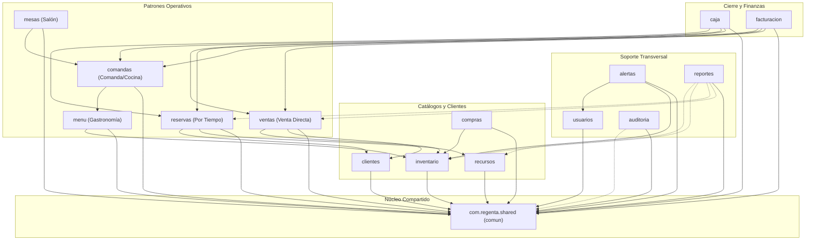

# Fase 0: Inventario y Análisis de la Arquitectura

Documento exhaustivo de inventario y análisis técnico del backend de **Regenta**, como paso previo a la migración de microservicios a un **monolito modular con Spring Modulith**.

---

## 1. Inventario de los Microservicios / Componentes

El backend de Regenta cuenta con 16 servicios ejecutables (15 de dominio de negocio + 1 API Gateway) y 1 librería compartida (`comun`), totalizando 17 módulos de código fuente:

| # | Servicio / Módulo | Paquete Base | Puerto | Schema / BD | Entidades Principales | Endpoints REST Principales | Dependencias Relevantes |
|---|---|---|---|---|---|---|---|
| 1 | `gateway` | `com.regenta.gateway` | 8080 | N/A | Ninguna | Proxies de `/api/**`, `/actuator/health` | Spring Cloud Gateway, Reactive Security, Nimbus JWT |
| 2 | `comun` | `com.regenta.comun` | N/A | Compartido | `InboxEvento`, `OutboxEvento` | Handlers `@RestControllerAdvice` globales | Spring Data JPA, AMQP, AOP, Validation |
| 3 | `servicio-usuarios` | `com.regenta.usuarios` | 8081 | `usuarios` (`regenta_usuarios`) | `Usuario`, `Rol`, `Permiso`, `Negocio`, `Sucursal`, `Modulo`, `Plan`, `ConfiguracionNegocio`, `Impuesto`, `AccesoPorCorreo`, `RefreshToken` | `/api/usuarios/auth/**`, `/api/usuarios/usuarios/**`, `/api/usuarios/roles/**`, `/api/usuarios/sucursales/**`, `/api/usuarios/negocios/**`, `/api/usuarios/modulos/**`, `/api/usuarios/configuracion/**` | Spring Security, JJWT / Nimbus, Spring Data JPA, Flyway |
| 4 | `servicio-clientes` | `com.regenta.clientes` | 8082 | `clientes` (`regenta_clientes`) | `Cliente`, `ClienteMetricas`, `CuentaPorCobrar`, `Interaccion`, `Recaudo` | `/api/clientes/**`, `/api/clientes/{id}/metricas`, `/api/clientes/{id}/cartera`, `/api/clientes/{id}/interacciones`, `/api/clientes/{id}/seguimientos` | Spring Data JPA, Flyway, PostgreSQL (pg_trgm) |
| 5 | `servicio-inventario` | `com.regenta.inventario` | 8083 | `inventario` (`regenta_inventario`) | `Producto`, `Categoria`, `Existencia`, `Lote`, `MovimientoInventario`, `Bodega`, `ListaDePrecios`, `ReservaStock`, `Traslado`, `Ajuste` | `/api/inventario/productos/**`, `/api/inventario/categorias/**`, `/api/inventario/lotes/**`, `/api/inventario/movimientos/**`, `/api/inventario/bodegas/**`, `/api/inventario/listas-precios/**` | Spring Data JPA, Flyway, RestClient (Builder) |
| 6 | `servicio-ventas` | `com.regenta.ventas` | 8084 | `ventas` (`regenta_ventas`) | `Venta`, `VentaLinea`, `PagoDeVenta`, `Cotizacion`, `CotizacionLinea`, `Devolucion`, `Saga` | `/api/ventas/**`, `/api/ventas/{id}/pagos`, `/api/ventas/{id}/confirmacion`, `/api/ventas/{id}/anulacion`, `/api/ventas/offline/**`, `/api/cotizaciones/**` | Spring Data JPA, Flyway, RestClient |
| 7 | `servicio-compras` | `com.regenta.compras` | 8085 | `compras` (`regenta_compras`) | `Proveedor`, `OrdenDeCompra`, `OrdenCompraLinea`, `Recepcion`, `RecepcionLinea`, `CuentaPorPagar`, `PagoProveedor`, `SugerenciaDeCompra` | `/api/compras/proveedores/**`, `/api/compras/ordenes/**`, `/api/compras/recepciones/**`, `/api/compras/cuentas-por-pagar/**`, `/api/compras/sugerencias/**` | Spring Data JPA, Flyway |
| 8 | `servicio-recursos` | `com.regenta.recursos` | 8086 | `recursos` (`regenta_recursos`) | `Recurso`, `TipoDeRecurso`, `Tarifa`, `PoliticaCancelacion`, `ServicioAdicional`, `AtributoTipoRecurso` | `/api/recursos/**`, `/api/recursos/tipos/**`, `/api/recursos/tarifas/**`, `/api/recursos/bloqueos/**`, `/api/recursos/politicas-cancelacion/**` | Spring Data JPA, Flyway, RestClient |
| 9 | `servicio-reservas` | `com.regenta.reservas` | 8087 | `reservas` (`regenta_reservas`) | Modelo inmutable gestionado con JdbcTemplate: `Reserva`, `Estancia`, `ConsumoDeEstancia`, `Ocupante`, `PagoDeReserva` (GIST range `tstzrange`) | `/api/reservas/**`, `/api/reservas/disponibilidad/**`, `/api/reservas/estancias/**`, `/api/reservas/{id}/checkin`, `/api/reservas/{id}/checkout` | Spring JdbcTemplate, Flyway, RestClient, PostgreSQL GIST |
| 10 | `servicio-menu` | `com.regenta.menu` | 8088 | `menu` (`regenta_menu`) | `Carta`, `CategoriaMenu`, `ItemDeMenu`, `Modificador`, `GrupoDeModificadores`, `Receta`, `EstacionDeCocina`, `DisponibilidadDiaria` | `/api/menu/cartas/**`, `/api/menu/items/**`, `/api/menu/modificadores/**`, `/api/menu/recetas/**`, `/api/menu/estaciones/**`, `/api/menu/disponibilidad/**` | Spring Data JPA, Flyway, RestClient |
| 11 | `servicio-mesas` | `com.regenta.mesas` | 8089 | `mesas` (`regenta_mesas`) | `Mesa`, `Zona`, `SesionDeMesa`, `MesaDeSesion` | `/api/mesas/**`, `/api/mesas/zonas/**`, `/api/mesas/sesiones/**`, `/api/mesas/plano` | Spring Data JPA, Flyway |
| 12 | `servicio-comandas` | `com.regenta.comandas` | 8090 | `comandas` (`regenta_comandas`) | `Comanda`, `ComandaLinea`, `ComandaLineaModificador`, `Cuenta`, `CuentaLinea`, `PagoComanda`, `TicketCocina` | `/api/comandas/**`, `/api/comandas/cocina/**`, `/api/comandas/cuentas/**` | Spring Data JPA, Flyway, RestClient |
| 13 | `servicio-facturacion`| `com.regenta.facturacion` | 8091 | `facturacion` (`regenta_facturacion`) | `Factura`, `FacturaLinea`, `FacturaImpuesto`, `Resolucion`, `Certificado`, `Contingencia` | `/api/facturacion/facturas/**`, `/api/facturacion/resoluciones/**`, `/api/facturacion/notas-credito/**`, `/api/facturacion/contingencias/**`, `/api/facturacion/transmisiones/**` | Spring Data JPA, Flyway, BouncyCastle / DIAN XML |
| 14 | `servicio-caja` | `com.regenta.caja` | 8092 | `caja` (`regenta_caja`) | `Caja`, `SesionDeCaja`, `MovimientoDeCaja`, `ArqueoDenominacion`, `ConfigDeCaja` | `/api/caja/cajas/**`, `/api/caja/sesiones/**`, `/api/caja/movimientos/**`, `/api/caja/reportes/**`, `/api/caja/config/**` | Spring Data JPA, Flyway |
| 15 | `servicio-alertas` | `com.regenta.alertas` | 8093 | `alertas` (`regenta_alertas`) | `Alerta`, `ReglaAlerta`, `TipoAlerta`, `PreferenciaNotificacion`, `DispositivoPush`, `Entrega` | `/api/alertas/mias/**`, `/api/alertas/reglas/**`, `/api/alertas/dispositivos/**`, `/api/alertas/preferencias/**`, `/api/alertas/vigilancia/**` | Spring Data JPA, Flyway, RestClient |
| 16 | `servicio-reportes` | `com.regenta.reportes` | 8094 | `reportes` (`regenta_reportes`) | `DimCliente`, `DimProducto`, `DimSucursal`, `DimUsuario` (Data Mart estrella con tablas agregadas) | `/api/reportes/ventas/**`, `/api/reportes/panel/**`, `/api/reportes/metricas/**`, `/api/reportes/exportaciones/**` | Spring Data JPA, Flyway, Apache POI (5.3.0), Apache PDFBox (3.0.3) |
| 17 | `servicio-auditoria` | `com.regenta.auditoria` | 8095 | `auditoria` (`regenta_auditoria`) | `OperacionSync`, `ConflictoSync`, `Dispositivo` (Bitácora inmutable append-only) | `/api/auditoria/eventos/**`, `/api/auditoria/sincronizacion/**`, `/api/auditoria/sincronizacion/cambios/**`, `/api/auditoria/conflictos/**` | Spring Data JPA, Flyway |

---

## 2. Rutas del Gateway y Preservación de URLs

En `gateway/src/main/resources/application.yml`, Spring Cloud Gateway define 15 rutas de enrutamiento:

```yaml
spring:
  cloud:
    gateway:
      server:
        webflux:
          routes:
            - id: servicio-usuarios
              uri: ${SERVICIO_USUARIOS_URI:http://localhost:8081}
              predicates:
                - Path=/api/usuarios/**
            - id: servicio-clientes
              uri: ${SERVICIO_CLIENTES_URI:http://localhost:8082}
              predicates:
                - Path=/api/clientes/**
            - id: servicio-inventario
              uri: ${SERVICIO_INVENTARIO_URI:http://localhost:8083}
              predicates:
                - Path=/api/inventario/**
            - id: servicio-ventas
              uri: ${SERVICIO_VENTAS_URI:http://localhost:8084}
              predicates:
                - Path=/api/ventas/**
            - id: servicio-compras
              uri: ${SERVICIO_COMPRAS_URI:http://localhost:8085}
              predicates:
                - Path=/api/compras/**
            - id: servicio-recursos
              uri: ${SERVICIO_RECURSOS_URI:http://localhost:8086}
              predicates:
                - Path=/api/recursos/**
            - id: servicio-reservas
              uri: ${SERVICIO_RESERVAS_URI:http://localhost:8087}
              predicates:
                - Path=/api/reservas/**
            - id: servicio-menu
              uri: ${SERVICIO_MENU_URI:http://localhost:8088}
              predicates:
                - Path=/api/menu/**
            - id: servicio-mesas
              uri: ${SERVICIO_MESAS_URI:http://localhost:8089}
              predicates:
                - Path=/api/mesas/**
            - id: servicio-comandas
              uri: ${SERVICIO_COMANDAS_URI:http://localhost:8090}
              predicates:
                - Path=/api/comandas/**
            - id: servicio-facturacion
              uri: ${SERVICIO_FACTURACION_URI:http://localhost:8091}
              predicates:
                - Path=/api/facturacion/**
            - id: servicio-caja
              uri: ${SERVICIO_CAJA_URI:http://localhost:8092}
              predicates:
                - Path=/api/caja/**
            - id: servicio-alertas
              uri: ${SERVICIO_ALERTAS_URI:http://localhost:8093}
              predicates:
                - Path=/api/alertas/**
            - id: servicio-reportes
              uri: ${SERVICIO_REPORTES_URI:http://localhost:8094}
              predicates:
                - Path=/api/reportes/**
            - id: servicio-auditoria
              uri: ${SERVICIO_AUDITORIA_URI:http://localhost:8095}
              predicates:
                - Path=/api/auditoria/**
```

### Análisis Clave de Rutas:
1. **Sin filtros de transformación:** NO se utiliza `StripPrefix`, `RewritePath` ni filtros similares. El Gateway pasaba la ruta completa `/api/<modulo>/**` directamente al microservicio respectivo.
2. **Controladores idénticos:** Cada microservicio ya tiene sus controladores mapeados con el prefijo `/api/<modulo>/...` (ej. `@RequestMapping("/api/ventas")`, `@RequestMapping("/api/inventario")`). Por consiguiente, en el monolito modular **las rutas REST permanecen 100% idénticas** sin necesidad de alterar ningún `@RequestMapping` en 14 de los 15 módulos.
3. **Caso especial `CotizacionesControlador`:** En `servicio-ventas`, `CotizacionesControlador` está mapeado en `/api/cotizaciones`. Al fusionarse en el monolito modular, responderá directamente en `/api/cotizaciones`.

---

## 3. Comunicación Síncrona entre Servicios (HTTP con `RestClient`)

El proyecto no utiliza Spring Cloud OpenFeign ni WebClient reactivo en los servicios de negocio; utiliza **`org.springframework.web.client.RestClient`** de Spring Boot 3 / Spring Framework 6.

| Consumidor | Proveedor | Clase de Adaptador | URL Invocada | Propósito |
|---|---|---|---|---|
| `servicio-alertas` | `servicio-inventario` | `ConsultaDeInventarioHttp` | `GET /api/inventario/lotes/por-vencer?ventanaDias={dias}` | Consultar lotes próximos a vencer durante barrido nocturno |
| `servicio-alertas` | `servicio-usuarios` | `DirectorioDeUsuariosHttp` | `GET /api/usuarios/usuarios/con-rol?rol={rol}` | Consultar destinatarios con determinado rol para enviar notificaciones |
| `servicio-comandas` | `servicio-menu` | `CatalogoDeMenuHttp` | `GET /api/menu/items/{id}`, etc. | Validar items, precios y modificadores al abrir o agregar líneas de comanda |
| `servicio-menu` | `servicio-inventario` | `CostosDeInventarioHttp` | `GET /api/inventario/productos/{id}/costo` | Obtener costo ponderado de insumos para calcular costo de recetas |
| `servicio-recursos` | `servicio-reservas` | `ConsultaDeReservasDeRecursoHttp`| `GET /api/reservas/...` | Verificar si un recurso tiene reservas activas antes de bloquearlo o cambiar estado |
| `servicio-reservas` | `servicio-recursos` | `CatalogoDeRecursosHttp` | `GET /api/recursos/{id}` | Obtener datos del recurso (capacidad, tarifas, checkin/checkout) al reservar |
| `servicio-reservas` | `servicio-clientes` | `ConsultaDeClientesHttp` | `GET /api/clientes/{id}` | Validar datos del huésped/cliente titular de la reserva |
| `servicio-ventas` | `servicio-clientes` | `ConsultaDeClientesHttp` | `GET /api/clientes/{id}` | Validar cliente titular en la venta |
| `servicio-ventas` | `servicio-clientes` | `ConsultaDeCreditoHttp` | `GET /api/clientes/{id}/cartera` | Validar cupo de crédito y días de mora antes de permitir venta a crédito |

> [!WARNING] **Dependencia Cíclica Detectada:**
> `servicio-recursos` invoca a `servicio-reservas` de forma síncrona, y `servicio-reservas` invoca a `servicio-recursos`. En Spring Modulith, los ciclos directos entre módulos provocan fallo en `ApplicationModules.verify()`.
> **Solución arquitectónica:** En el monolito modular, la verificación de reservas activas o disponibilidad se resuelve mediante eventos de dominio asíncronos o trasladando la consulta de disponibilidad a un contrato desacoplado.

---

## 4. Comunicación Asíncrona (RabbitMQ)

### Topología Actual en RabbitMQ
- **Exchange:** `regenta.eventos` (Tipo: `topic`, durable).
- **Exchange Muertos / DLX:** `regenta.eventos.dlx` (Tipo: `topic`).
- **Mecanismo Outbox:** Cada microservicio usa `com.regenta.comun.eventos.RegistroDeEventos` para guardar en su tabla local `outbox_eventos` dentro de su transacción de base de datos. Un `@Scheduled` en `PublicadorDeOutbox` lee los pendientes y publica a RabbitMQ serializando a JSON con cabeceras (`negocio_id`, `tipo_evento`, `agregado_tipo`, `agregado_id`, `trace_id`, `servicio_origen`).
- **Mecanismo Inbox:** Cada consumidor registra el `messageId` en `inbox_eventos` para garantizar idempotencia.

### Matriz Completa de Eventos Publicados y Consumidos

| Evento (Routing Key) | Publicador | Consumidor(es) | Propósito en el Negocio |
|---|---|---|---|
| `negocio_creado` | `servicio-usuarios` | `servicio-facturacion`, `servicio-reportes` | Inicializar configuración de emisor fiscal y dimensiones de reportes |
| `configuracion_negocio_actualizada` | `servicio-usuarios` | `servicio-ventas`, `servicio-facturacion` | Sincronizar reglas de venta y datos fiscales del negocio |
| `usuario_invitado` / `usuario_activado` | `servicio-usuarios` | `servicio-auditoria` | Auditoría de usuarios |
| `cliente_creado` | `servicio-clientes` | `servicio-auditoria`, `servicio-reportes` | Registrar nuevo cliente en bitácora y dimensión |
| `solicitar_reserva_stock` | `servicio-ventas` (Saga) | `servicio-inventario` | Iniciar reserva temporal de stock para la venta |
| `stock_reservado` | `servicio-inventario` | `servicio-ventas` (Saga) | Confirmar que el stock fue reservado exitosamente |
| `stock_reserva_fallida` | `servicio-inventario` | `servicio-ventas` (Saga) | Notificar fallo de stock; la saga aborta la venta |
| `venta_completada` | `servicio-ventas` | `servicio-inventario`, `servicio-caja`, `servicio-clientes`, `servicio-facturacion`, `servicio-reportes` | Confirmar salida definitiva de stock, generar movimiento de caja, actualizar métricas de cliente, emitir factura y actualizar reportes |
| `venta_a_credito` | `servicio-ventas` | `servicio-clientes` | Generar cuenta por cobrar en cartera del cliente |
| `venta_anulada` | `servicio-ventas` | `servicio-clientes`, `servicio-reportes` | Reversar métricas de cliente y actualizar reportes |
| `devolucion_registrada` | `servicio-ventas` | `servicio-facturacion` | Generar nota crédito fiscal asociada |
| `venta_offline_en_conflicto` | `servicio-ventas` | `servicio-alertas`, `servicio-auditoria` | Generar alerta de discrepancia en ventas sincronizadas |
| `conflicto_sync_vencido` | `servicio-auditoria` | `servicio-alertas` | Notificar al administrador sobre conflicto pendiente por resolver |
| `stock_bajo_minimo` | `servicio-inventario` | `servicio-alertas`, `servicio-compras` | Generar alerta de inventario y sugerencia de orden de compra |
| `lote_por_vencer` | `servicio-alertas` / `servicio-inventario` | `servicio-alertas` | Notificar proximidad de caducidad |
| `stock_actualizado` | `servicio-inventario` | `servicio-menu`, `servicio-reportes` | Ajustar disponibilidad de platos en el menú y reportes |
| `costo_producto_actualizado` | `servicio-inventario` | `servicio-menu` | Recalcular costo estimado de recetas |
| `pedido_completado` | `servicio-comandas` | `servicio-caja`, `servicio-clientes`, `servicio-facturacion`, `servicio-menu`, `servicio-reportes` | Impactar sesión de caja, consumo de cliente, facturación y reportes |
| `comanda_cerrada` | `servicio-comandas` | `servicio-mesas` | Liberar mesa automáticamente |
| `estancia_finalizada` | `servicio-reservas` | `servicio-caja`, `servicio-clientes`, `servicio-facturacion`, `servicio-reportes` | Liquidar saldo de estancia, consumos de habitación y facturar |
| `anticipo_reserva_cobrado` | `servicio-reservas` | `servicio-caja` | Ingresar pago anticipado a la caja activa |
| `reserva_cancelada` / `reserva_no_show`| `servicio-reservas` | `servicio-reportes` | Métricas de ocupación y tasa de cancelación |
| `bloqueo_recurso_creado` / `levantado` | `servicio-recursos` | `servicio-reportes` | Métrica de horas de indisponibilidad de recursos |
| `recurso_creado` / `actualizado` / `eliminado` | `servicio-recursos` | `servicio-reportes` | Sincronizar catálogo de recursos en reportes |
| `mesa_creada` / `actualizada` / `eliminada` | `servicio-mesas` | `servicio-reportes` | Sincronizar catálogo de mesas en reportes |
| `factura_emitida` | `servicio-facturacion` | `servicio-facturacion` | Iniciar cola de firma digital y transmisión a DIAN |
| `caja_descuadrada` | `servicio-caja` | `servicio-alertas` | Alertar al gerente sobre descuadre de cierre de turno |
| `#` (todos los eventos) | Cualquier servicio | `servicio-auditoria` (`AuditorDeEventos`) | Bitácora global inmutable de auditoría |

---

## 5. Configuración de Seguridad, Multi-Tenancy y `@RequiereModulo`

### Validación de JWT
1. **En el Gateway:**
   - `ConfiguracionDeSeguridad.java`: Usa `ReactiveJwtDecoder` (HS256) validando `JwtTimestampValidator` y `JwtIssuerValidator`.
   - `FiltroDeContexto.java`: Extrae claims del JWT (`negocio_id`, `sub`, `plan`, `patron`, `roles`, `modulos`, `permisos`, `sucursales`, `estado_negocio`).
   - Bloquea peticiones si `estado_negocio` es `SUSPENDIDO` o `CANCELADO` (HTTP 402 Payment Required).
   - Escribe las cabeceras HTTP internas: `X-Regenta-Negocio`, `X-Regenta-Usuario`, `X-Regenta-Plan`, `X-Regenta-Patron`, `X-Regenta-Roles`, `X-Regenta-Modulos`, `X-Regenta-Permisos`, `X-Regenta-Sucursales`.
2. **En cada Microservicio:**
   - Cada servicio cuenta con `FiltroDeNegocio` (en `comun`), que lee `X-Regenta-Negocio` y demás cabeceras, poblando el `ContextoDeNegocio` (`ThreadLocal<DatosDelNegocio>`).

### Multi-Tenancy y Aislamiento en Base de Datos
- **PostgreSQL Row-Level Security (RLS):** Cada tabla de negocio tiene `ENABLE ROW LEVEL SECURITY; FORCE ROW LEVEL SECURITY;`.
- **Aspecto `AislamientoPorNegocio`:** Corre alrededor de cualquier método `@Transactional` (con orden 10, por dentro de la transacción). Ejecuta:
  `SELECT set_config('app.negocio_id', :negocio, true);`
  Esto configura la variable de sesión para la transacción PostgreSQL actual, haciendo que la política de RLS filtre automáticamente los registros sin riesgo de fuga entre conexiones de HikariCP.
- **Barridos Multinegocio (`comun/barridos`):** Usan un pool y rol secundario con privilegio `BYPASSRLS` (`reg_<servicio>_barridos`) únicamente para descubrir qué negocios tienen trabajo pendiente, pero el procesamiento en sí se ejecuta negocio por negocio bajo el contexto normal con RLS.

### `@RequiereModulo` y `@RequierePermiso`
- **Anotación `@RequiereModulo(Modulo.XXX)`:** Gestionada por el aspecto `GuardiaDeModulos`. Intercepta llamadas a controladores o servicios, valida si `ContextoDeNegocio.actual().tieneModulo(modulo)` y si no, lanza `ModuloNoIncluidoException` (HTTP 403 Forbidden RFC 7807).
- **Anotación `@RequierePermiso("...")`:** Gestionada por el aspecto `GuardiaDePermisos`. Valida si el usuario tiene el permiso requerido en sus claims; si no, lanza `SinPermisoException` (HTTP 403 Forbidden).

---

## 6. Migraciones de Base de Datos (Flyway)

- **Herramienta:** Flyway.
- **Ubicación:** `src/main/resources/db/migration/` en cada uno de los 15 microservicios de datos.
- **Estructura de Versionamiento Actual:** Cada microservicio inicia en `V1__esquema_inicial.sql`, seguido por `V2__rls.sql` y extensiones sucesivas (`V3...`, `V4...`, etc.).
- **Total de scripts Flyway identificados:** 60 archivos SQL distribuidos en los 15 servicios.
- **Estrategia para el Monolito:** Dado que en la arquitectura de microservicios cada servicio tenía su propia base de datos con schema `public`, en el monolito modular unificado:
  - Se reubicarán a `classpath:db/migration/<modulo>/` (ej. `db/migration/usuarios`, `db/migration/inventario`).
  - Se ejecutará Flyway programáticamente para cada schema individual (`usuarios`, `clientes`, `inventario`, etc.), creando y manteniendo una tabla `flyway_schema_history` independiente por schema (`<modulo>.flyway_schema_history`).
  - Esto evita conflictos de versiones `V1`, `V2` entre módulos y preserva intacto el historial de migraciones de las bases de datos de producción ya desplegadas.

---

## 7. Código Duplicado y Componentes Compartidos

El módulo `comun` ya provee gran parte de la infraestructura transversal:
1. `com.regenta.comun.errores`: Excepciones canónicas (`ReglaDeNegocioException`, `NoEncontradoException`, `ConflictoDeEstadoException`, `SinPermisoException`, `ModuloNoIncluidoException`, `ServicioNoDisponibleException`, etc.) y `ManejadorDeErrores` (`@RestControllerAdvice`).
2. `com.regenta.comun.negocio`: `ContextoDeNegocio`, `FijadorDeNegocio`, `AislamientoPorNegocio`, `GuardiaDeModulos`, `GuardiaDePermisos`.
3. `com.regenta.comun.barridos`: Infraestructura de jobs de barrido en segundo plano.
4. `com.regenta.comun.bbdd`: Validación de funciones PostgreSQL leakproof para índices trigram sobre RLS.

**Código redundante que se eliminará con la fusión:**
- Clientes HTTP manuales (`ConsultaDeInventarioHttp`, `CatalogoDeMenuHttp`, `CostosDeInventarioHttp`, etc.): Se reemplazan por interfaces directas de Spring Modulith en memoria.
- Mecanismo RabbitMQ Outbox (`PublicadorDeOutbox` con poll scheduled) e Inbox (`InboxIdempotente`): Se reemplaza por el Event Publication Registry de Spring Modulith + JPA.
- Clases de configuración duplicadas de DataSource, Flyway y TransactionManager en 15 servicios.
- 16 clases `@SpringBootApplication` independientes y 16 Dockerfiles.

---

## 8. Conflictos Potenciales al Fusionar

1. **Colisión de Nombres de Beans de Spring:**
   - `CuentasControlador` existe en `servicio-clientes` y en `servicio-comandas`.
   - `DisponibilidadControlador` existe en `servicio-menu` y en `servicio-reservas`.
   - `AsignadorDeConsecutivos` existe en `caja`, `comandas`, `compras`, `facturacion`, `reservas` y `ventas`.
   - `PasarelaDeCorreoStub` existe en `alertas` y en `reportes`.
   - `ConsultaDeClientesHttp` existe en `reservas` y en `ventas`.
   *Solución:* Configurar `FullyQualifiedAnnotationBeanNameGenerator` en la aplicación de Spring Boot para que los nombres de beans incluyan el paquete completo (ej. `com.regenta.clientes.api.CuentasControlador`), eliminando cualquier colisión.
2. **Colisión de Nombres de Clases / DTOs:**
   - DTOs homónimos como `SesionDelNegocio`, `SolicitudDeApertura`, `SolicitudDeLinea`, `SolicitudDePago`, `SolicitudDeRecepcion`, `CategoriaDelNegocio`, `SolicitudDeCategoria`, `CotizacionDeEstadia`, `SolicitudDeCotizacion`.
   *Solución:* Al estar aislados en los paquetes de cada módulo (`com.regenta.<modulo>.*`), los DTOs no colisionan en tiempo de ejecución.
3. **Colisión de Entidades JPA en el Metamodel de Hibernate:**
   - En Hibernate, si dos `@Entity` tienen el mismo nombre simple de clase, chocan en el metamodelo de persistencia. En este repositorio, casi todas las entidades tienen nombres distintos salvo `ConfigDeCaja` o enums como `MetodoDePago`, `TipoDocumento` y `EstadoReserva`.
   *Solución:* Configurar `@Table(schema = "<modulo>")` en todas las entidades, y asegurar que si hubiera dos `@Entity` con el mismo nombre simple, se califiquen con `@Entity(name = "<modulo>_<Entidad>")`.
4. **Dependencias Cíclicas entre Módulos:**
   - `recursos` <-> `reservas`: Se desacopla en Fase 2 mediante un contrato de consulta asíncrono o API de dominio pública unidireccional.

---

## 9. Diagrama de Dependencias entre Módulos



---

## 10. Riesgos Identificados y Decisiones Arquitectónicas

1. **Saga de Confirmación de Ventas (Transacciones Distribuidas -> Transacción Local / Modular):**
   - *Situación actual:* En `servicio-ventas`, `SagaDeConfirmacionDeVenta` utilizaba RabbitMQ para enviar `solicitar_reserva_stock` a `servicio-inventario`, esperando la respuesta `stock_reservado` o `stock_reserva_fallida`.
   - *Decisión:* Con Spring Modulith, la saga puede ejecutarse invocando la API de inventario en memoria dentro de la misma transacción (o manteniendo la semántica de eventos con `@ApplicationModuleListener`). Para máxima seguridad y sin romper la semántica actual, se conserva el flujo basado en eventos en proceso, garantizando consistencia eventual mediante el Event Publication Registry.
2. **Manejo de Schemas en PostgreSQL:**
   - *Decisión:* Usaremos un solo DataSource HikariCP conectado a la base de datos PostgreSQL, y una configuración de Flyway que recorra ordenadamente cada schema (`usuarios`, `clientes`, `inventario`, `ventas`, `compras`, `recursos`, `reservas`, `menu`, `mesas`, `comandas`, `facturacion`, `caja`, `alertas`, `reportes`, `auditoria`), creando el schema (`CREATE SCHEMA IF NOT EXISTS`) y ejecutando sus migraciones con su propia tabla de historial.
3. **Propagación de `TenantContext` en Eventos Asíncronos:**
   - *Decisión:* Dado que `ContextoDeNegocio` es un `ThreadLocal`, los listeners asíncronos (`@ApplicationModuleListener`) reciben eventos tipados (Records) que incluyen explícitamente `negocioId` y metadatos. El listener restablece el contexto de negocio antes de ejecutar la lógica del suscriptor.
4. **Ciclo entre `recursos` y `reservas`:**
   - *Decisión:* `servicio-recursos` consultaba a `servicio-reservas` a través de HTTP (`ConsultaDeReservasDeRecursoHttp`) únicamente para validar si existían reservas activas antes de eliminar un recurso. Esa verificación se formaliza en una API desacoplada de sólo lectura (`reservas.api.ConsultaDeReservasActivas`), rompiendo la llamada cruzada bidireccional y cumpliendo con las reglas de Spring Modulith.
